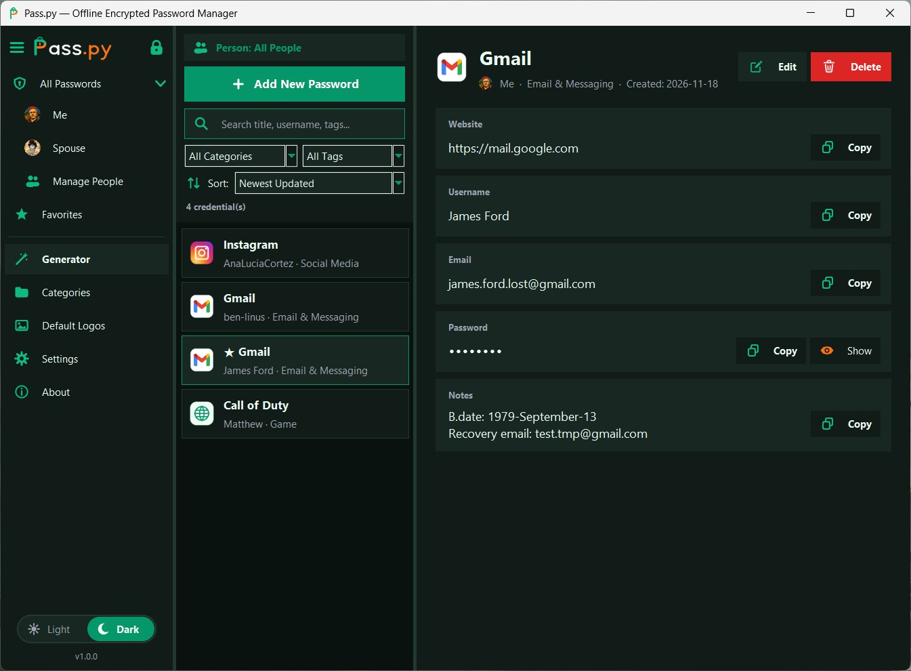
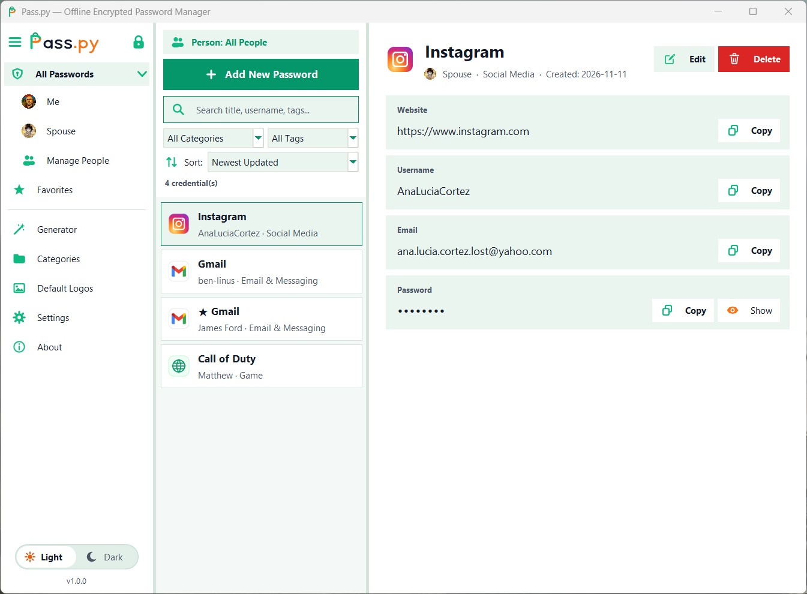
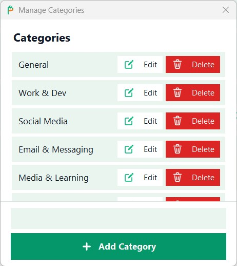
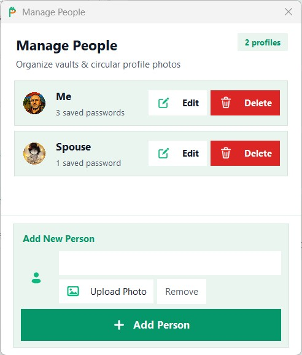
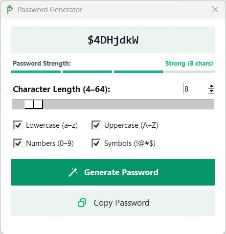
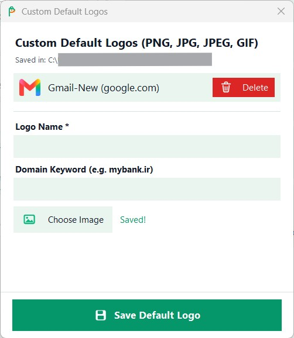
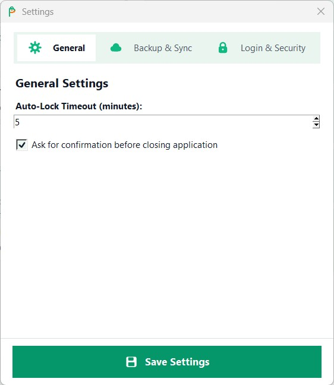
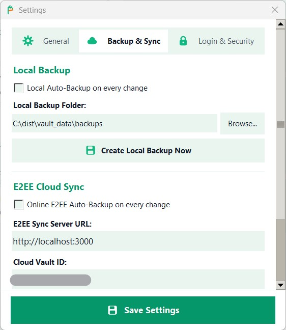
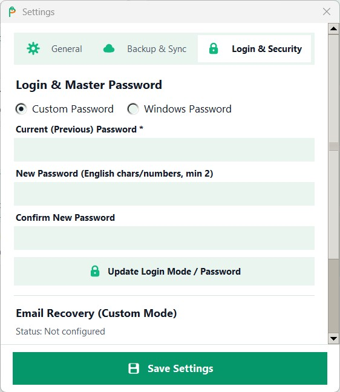

# Pass.py

**Zero-Knowledge Offline Encrypted Password Manager for Windows**

`Version 1.1.0` · `Python 3.9+` · `Windows 10 / 11` · `AES-256-GCM & PBKDF2-HMAC-SHA256`

---

## Overview

**Pass.py** is a portable, modular Python desktop application for offline credential storage on Windows. All secrets are encrypted client-side before being saved to a local SQLite database, all UI icons and popular service logos are embedded directly into the source package, and runtime files are stored cleanly in a portable `vault_data/` directory alongside `Pass.py` or `Pass.exe`.

---

## Screenshots

<table>
  <tr>
    <td align="center" width="50%">
      <br />
      <sub><strong>Dark Theme Workspace</strong></sub>
    </td>
    <td align="center" width="50%">
      <br />
      <sub><strong>Light Theme Workspace</strong></sub>
    </td>
  </tr>
</table>

<details>
<summary><strong>View More Screenshots (Dialogs &amp; Settings)</strong></summary>
<br />

<table>
  <tr>
    <td align="center" width="25%">
      <br />
      <sub><strong>Manage Categories</strong></sub>
    </td>
    <td align="center" width="25%">
      <br />
      <sub><strong>Manage People</strong></sub>
    </td>
    <td align="center" width="25%">
      <br />
      <sub><strong>Password Generator</strong></sub>
    </td>
    <td align="center" width="25%">
      <br />
      <sub><strong>Custom Default Logos</strong></sub>
    </td>
  </tr>
</table>

<table>
  <tr>
    <td align="center" width="33%">
      <br />
      <sub><strong>Settings — General</strong></sub>
    </td>
    <td align="center" width="33%">
      <br />
      <sub><strong>Settings — Backup &amp; Sync</strong></sub>
    </td>
    <td align="center" width="33%">
      <br />
      <sub><strong>Settings — Login &amp; Security</strong></sub>
    </td>
  </tr>
</table>

</details>

---

## Core Features

### Security & Authentication
- **Client-Side Encryption**: Random 256-bit Data Encryption Key (`DEK`) used to encrypt each vault entry individually with **AES-256-GCM** (automatic **CTR-HMAC-SHA256** stdlib fallback when `cryptography` is not installed).
- **Key Derivation**: **PBKDF2-HMAC-SHA256** (`600,000` iterations, random 128-bit salt).
- **Dual Login Modes**:
  - **Custom Master Password**: Portable vault password usable across devices.
  - **Windows Account Password**: Native Win32 `LogonUserW` authentication paired with **Windows DPAPI** key wrapping.
- **Session & Brute-Force Protection**: Exponential cooldown after repeated failed unlock or OTP attempts, configurable inactivity auto-lock, automatic clipboard scrubbing, and full dialog/memory cleanup upon locking or exit.

### Organization & Interface
- **Multi-Person Profiles**: Manage separate credential profiles with custom circular avatars (`PNG`, `JPG/JPEG`, `GIF`).
- **Service Logos & Categories**: Automatic domain-based logo matching, reusable custom **Default Logos**, ordered categories (`General`, `Work & Dev`, `Social Media`, `Email & Messaging`, `Media & Learning`, `Bank & Finance`, `Shopping`, `Game`, `Government`), favorites, and sorting.
- **Password Tools & Themes**: Cryptographic random password generator (`secrets`), real-time strength bar, and smooth Light/Dark theme switching.

### Recovery & Backups
- **Email Password Recovery**: 16-character **Personal Recovery Key** (`XXXX-XXXX-XXXX-XXXX`) with optional **Google Gmail SMTP 6-Digit OTP** verification.
- **Local Backups**: Manual and automatic SQLite online backups saved to a configurable folder (retains the latest 15 snapshots).
- **Optional E2EE Sync**: Client-side encrypted push/pull snapshots for self-hosted compatible sync endpoints.

---

## Project Structure

```text
Pass.py/
├── Pass.py                     # Application entry point
├── build_portable.bat          # Windows portable .exe builder
├── LICENSE                     # MIT License
├── README.md
├── screenshots/                # UI screenshots for GitHub README
└── pass_vault/
    ├── __init__.py
    ├── app.py                  # Main window, lock screen, sidebar, list & detail views
    ├── assets.py               # Embedded PNG icons, site presets & default categories
    ├── calendar_picker.py      # Date picker dialog
    ├── dialogs_entries.py      # Entry, category, logo, people & generator dialogs
    ├── dialogs_security.py     # Settings, password recovery & About dialog
    ├── icons.py                # Image cache & circular avatar renderer
    ├── image_validator.py      # PNG/JPG/GIF validation, Win32 GDI+ support & domain matching
    ├── password_generator.py   # Random password generator & strength evaluator
    ├── paths.py                # Portable vault_data/ path resolver
    ├── recovery.py             # Gmail SMTP OTP & Recovery Key logic
    ├── repository.py           # Encrypted SQLite persistence, backups & E2EE sync
    ├── scroll_helper.py        # Bounded scroll helper
    ├── security.py             # AES-256-GCM / CTR-HMAC engine & password validation
    ├── strength_bar.py         # Password strength bar widget
    ├── theme.py                # Light/Dark palettes & color interpolation
    ├── theme_switch.py         # Day/Night theme toggle widget
    └── windows_auth.py         # Win32 LogonUserW & DPAPI bindings
```

---

## Installation & Running

### Prerequisites
- **Windows 10 / 11** (recommended for Windows Account login, DPAPI, High-DPI scaling, and GDI+ support)
- **Python 3.9+** with **Tkinter** enabled (included by default in the official [python.org](https://www.python.org/downloads/) installer)

### Run from Source
```bat
git clone https://github.com/samimi-dev/Pass.py.git
cd Pass.py
pip install cryptography pillow
python Pass.py
```

> **Note:** `Pass.py` also runs without external packages using built-in standard-library fallbacks. Installing `cryptography` and `pillow` enables hardware-accelerated AES-256-GCM and faster image processing.

---

## Building a Portable Windows Package

Double-click **`build_portable.bat`** or run it from Command Prompt inside the project folder:

```bat
build_portable.bat
```

The script verifies Python and Tkinter, installs `cryptography`, `pillow`, and `pyinstaller`, embeds the application icon and Windows version metadata (`--onedir --noupx`), and creates:
- Portable folder: **`dist\Pass\Pass.exe`**
- Ready-to-distribute archive: **`dist\Pass-v1.1.0-Windows-Portable.zip`**

Manual command:
```bat
python -m pip install --upgrade cryptography pillow pyinstaller
python -m PyInstaller --noconfirm --clean --onedir --noupx --windowed --name Pass --collect-submodules pass_vault --hidden-import=cryptography --hidden-import=PIL.ImageTk --hidden-import=PIL.ImageOps --hidden-import=PIL.ImageDraw Pass.py
```

---

## Quick Start

1. **Create Your Vault**: Choose either a **Custom Master Password** or your **Windows Account Password**.
2. **Set Up Profiles**: Open **Manage People** in the sidebar to add profiles and upload circular avatars.
3. **Add Credentials**: Click **+ Add New Password**, enter credentials, and pick or upload a site logo.
4. **Configure Recovery**: Under **Settings -> Login & Security**, add a Recovery Email (and optional Gmail App Password for 6-digit OTP) and save your **16-character Recovery Key** offline.
5. **Back Up Regularly**: Configure your **Local Backup Folder** under **Settings -> Backup & Sync**.

---

## Portable Data Layout

All user data stays inside `vault_data/` next to `Pass.py` or `Pass.exe`:

```text
vault_data/
├── pass_vault.db   # Encrypted SQLite database
├── backups/        # Local SQLite backups (last 15 retained)
├── logos/          # Custom site logos
└── avatars/        # Profile avatars
```

`vault_data/`, `*.db`, `build/`, `dist/`, and `__pycache__/` are excluded via `.gitignore` so personal data is never committed.

---

## Troubleshooting

- **`build_portable.bat` fails or Windows Defender flags `Pass.exe`**: Ensure Python 3.9+ was installed with **Add python.exe to PATH** and **tcl/tk and IDLE**. Unsigned PyInstaller executables that call Win32 `LogonUserW`/`DPAPI` APIs can occasionally trigger heuristic (`!ml`) false positives in Windows Defender; building with `--onedir --noupx` minimizes this, or you can run directly from source via `python Pass.py`.
- **Gmail OTP fails to send**: Enable **2-Step Verification** on your Google Account and use a generated 16-character **App Password** instead of your regular Gmail password.

---

## License

This project is licensed under the [MIT License](LICENSE).

---

## Author

Developed by **samimi-dev** — [github.com/samimi-dev](https://github.com/samimi-dev/)
